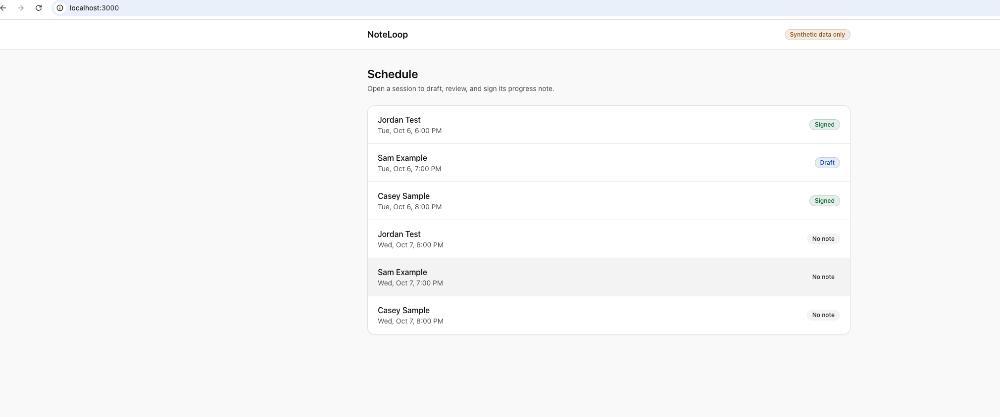
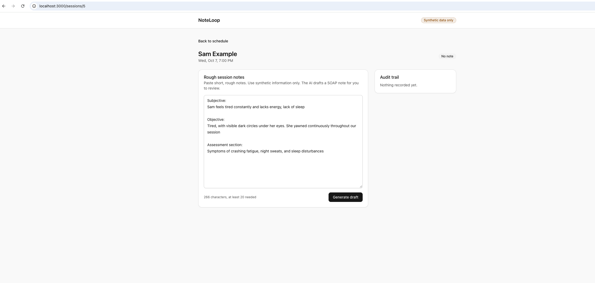
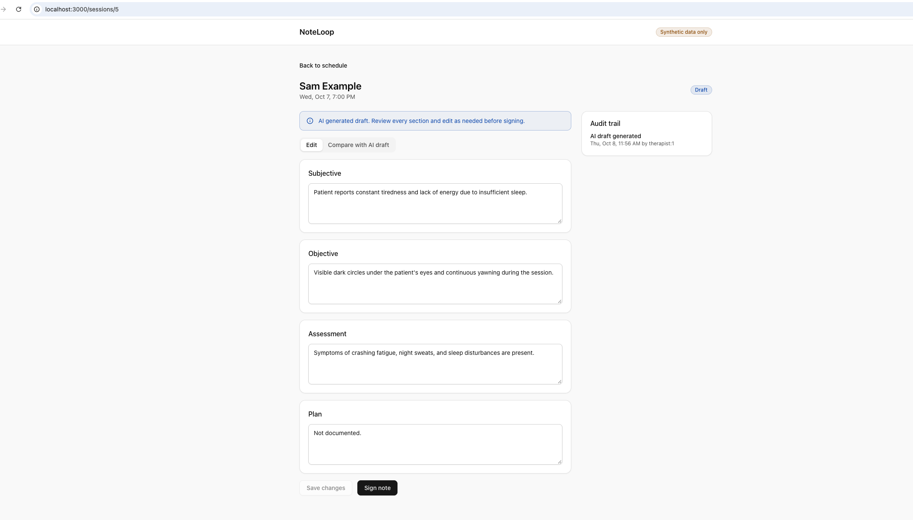
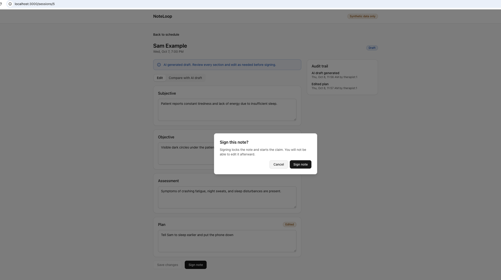
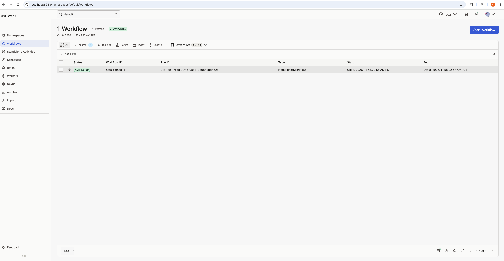
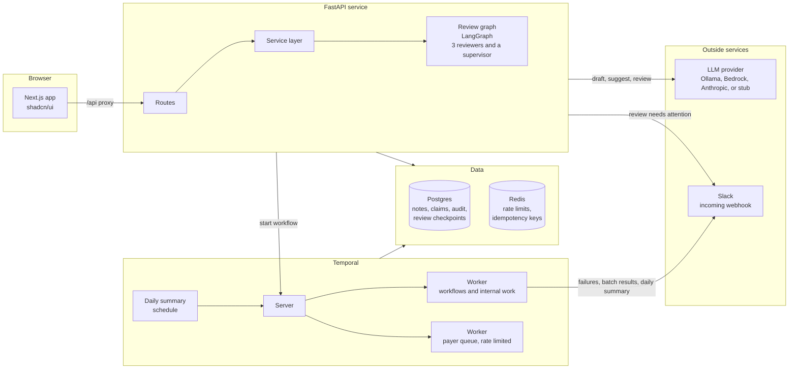

# NoteLoop

NoteLoop uses an LLM to turn a therapist's rough, unstructured session notes into a structured SOAP note (Subjective, Objective, Assessment, Plan). The therapist reviews, edits, and signs the draft. A review step checks the note before signing, and signing starts a background workflow that submits an insurance claim.

Status: portfolio project. Demo video: [link]. All data in this repo is synthetic, and the payer is simulated.

## What it does

The core step is turning free text into a structured note. For example, rough notes like this (a synthetic case from the evals):

> Client's mother died in March. Crying through the session and not eating well. Discussed a grief support group. Plan is a referral and weekly sessions.

become a SOAP note like this (an illustrative reference note, not captured model output):

| Section | Text |
| --- | --- |
| Subjective | Client's mother died in March. Client has trouble eating. |
| Objective | Client cried through most of the session. |
| Assessment | Grief reaction after her mother's death. |
| Plan | Refer to a grief support group and continue weekly sessions. |

The model's reply is validated against a schema, and guardrails flag anything the notes do not support. The full flow:

1. A therapist opens a session from the schedule and pastes rough notes.
2. The API asks an LLM for a SOAP note (Subjective, Objective, Assessment, Plan) and validates the reply against a schema before saving it.
3. The therapist edits any section. A section reduced to short phrases can be sent back for a more formal rewrite. The suggestion appears as a diff, and nothing changes until the therapist accepts it.
4. Before signing, the therapist can run a review. A LangGraph workflow runs three specialist reviewers in parallel (grounding, safety, billing readiness), and a supervisor merges their findings with rule based checks. It proposes fixes and pauses for the therapist to accept, dismiss, or rewrite each one, for up to two rounds. The review only returns proposed text and never changes the saved note.
5. A compare view shows the AI draft against the final text, word by word.
6. Signing locks the note, writes an audit event, and starts a Temporal workflow that creates and submits a claim to a simulated payer. A batch workflow can resubmit failed claims.

## Screenshots

Click any image to open it full size.

<table>
  <tr>
    <td align="center">
      
       Schedule
    </td>
    <td align="center">
      
       Rough notes
    </td>
    <td align="center">
      
       AI drafted SOAP note
    </td>
  </tr>
  <tr>
    <td align="center">
      
       Signing Note
    </td>
    <td align="center">
      
       Claim workflow in Temporal
    </td>
  </tr>
</table>

## System design

Two kinds of workflow run side by side. LangGraph runs the review before signing, inside the API, and pauses for the therapist. Temporal runs everything after signing, in separate workers.

More diagrams (the AI layer, the review sequence, and the signing sequence) are in [docs/ai-layer.md](docs/ai-layer.md).

## Tech stack

* Frontend: Next.js, React, TypeScript, Tailwind, shadcn/ui
* Backend: Python 3, FastAPI, SQLAlchemy, Pydantic
* Storage: Postgres, Redis
* Workflows: Temporal with the Python SDK for claims, and LangGraph with a Postgres checkpointer for the pre sign review
* AI: an LLM behind a provider interface (local Ollama, or a deterministic stub for tests), LangGraph for the review loop, LangSmith for optional tracing
* Local setup: Docker Compose

## Why I built this

Therapists spend a large share of their week on documentation. A progress note has to be structured and accurate, and the clinician who ran the session has to sign it. An LLM can write a first draft in seconds, but in healthcare a draft that nobody reviews is a liability.

I wanted to build the smallest realistic version of an AI feature that gives clinicians time back and keeps them responsible for the record. The model call is the easy part. Most of the work is the system around it: validation, review, an audit trail, and a way to see what clinicians change.

I also wanted to learn LangGraph by using it where it fits. Checking a note before signing calls a model and then has to stop and wait for a person, sometimes more than once, which is what a graph with saved state is good at. Temporal already handles the work after signing, so the two tools each get the job they suit. The review is a multi agent workflow: a grounding reviewer, a safety reviewer, and a billing reviewer run in parallel, and a supervisor merges what they find. It is not an autonomous agent. The graph, the round limit, and the exit rules are fixed in code, and the therapist makes every decision.

I also wanted to build the whole stack myself, with the schema at one end and the browser screen at the other, plus a background job behind it. My day job is in claims and payments, so the part after signing is modeled on that world: a claim that can fail and be retried, and failed claims that can be resubmitted in bulk. A Slack channel shows how the system is doing, because a claim that fails quietly is worse than one that fails loudly.

## Documentation

* [AI layer and workflows](docs/ai-layer.md): guardrails and validation path, review and signing sequences
* [Design decisions](docs/design-decisions.md): why it is built this way
* [Guardrails](docs/guardrails.md): grounding, safety mention, prompt injection, input limits
* [Cost, tracing and monitoring](docs/observability.md): metrics, alerts, LangSmith, edit rate, admin page, Slack

The suite covers the note flow, validation and retry of model output, wording suggestions, every branch of the review graph and its API, rate limiting, idempotent signing, Slack messages, the Temporal activities, and the batch endpoints. The end to end workflow tests need a Temporal test server.

## Responsible AI and PHI

* This is a portfolio project. It is not a medical device and has not been clinically validated.
* All patient data is synthetic. Do not enter real patient information.
* Drafts are labeled as AI generated until a therapist signs.
* Slack messages carry ids, statuses, and counts only. Never patient names or note text.
* A production version would need a business associate agreement with the LLM vendor, encryption at rest and in transit, role based access control, retention rules, and a security review.

## Known limitations

* There is no authentication. The audit trail attributes actions to the session owner.
* Tables are created at startup. There are no Alembic migrations yet.
* The payer is simulated unless `PAYER_MODE=adjudication`, and the claim is a stub record, not a real claim format.
* Adjudication mode polls for the decision. The Claims API has no webhook, so a decision can arrive up to one poll interval late, and a claim still undecided after the maximum wait needs a person (`manual_follow_up`). The batch resubmit does not poll, so a resubmitted claim stays `submitted` in this mode.
* Tables are created at startup, so an existing database needs the new `claims` columns (`amount`, `remote_claim_id`, `remote_status`) added by hand. `/claims/summary` still reports only the original four statuses.
* The Temporal dev server in Docker Compose keeps history in memory, so restarting it clears workflow history.
* The batch resubmit has an API endpoint but no button in the UI. A single failed or denied claim has a "Resubmit claim" button on the signed note, backed by `POST /sessions/{id}/claim/resubmit`. A claim in `manual_follow_up` has no button yet.
* Wording suggestions and the review have not been evaluated on a real model with clinician review. With the stub provider, the review is a set of simple rules and not real analysis. It is not a clinical safety control.
* Slack messages have only been tested against a mock server. The first real webhook may need small formatting changes.
* The review runs in the API process. The decision tracking step uses `workflow.patched`. Any further step added to a running workflow needs the same.

## Future improvements

1. Larger evals: more synthetic cases, edit distance against hand corrected references, and a scheduled run on real models with the results table added here.
2. A setting that requires a review before signing, and more specialist reviewers added the same way, such as a coding reviewer. Reviewers could also call tools, such as looking up the previous session, which would move the review from a fixed workflow toward an agent.
3. Feed accepted and rejected suggestions back to the model as examples.
4. Authentication, role based access control, and Postgres row level security.
5. Alembic migrations, and a Temporal setup with persistent storage.
6. A Grafana dashboard on `/metrics`, and a per model price table instead of one price pair.
7. Real claim generation and status tracking, with a payer acknowledgment signal and a timeout that moves a claim to manual review.
8. A UI for the batch resubmit with live progress, and a Slack button that starts it. The button needs Slack interactivity, request signature checks, and an allow list of users.
9. Error tracking through Sentry.
10. Streaming drafts to the browser.
11. More note formats (DAP, BIRP) and treatment plans.
