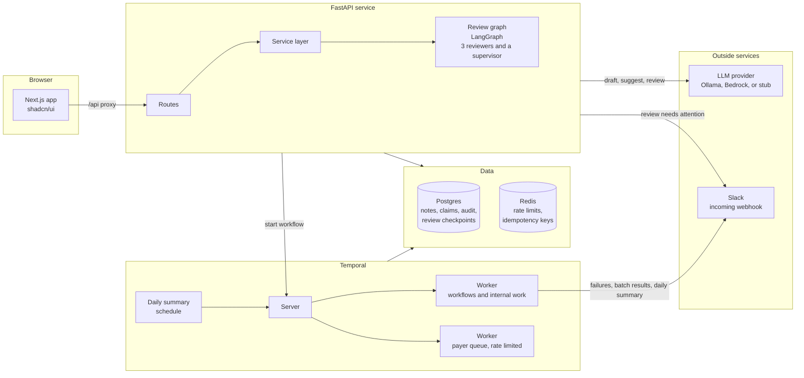
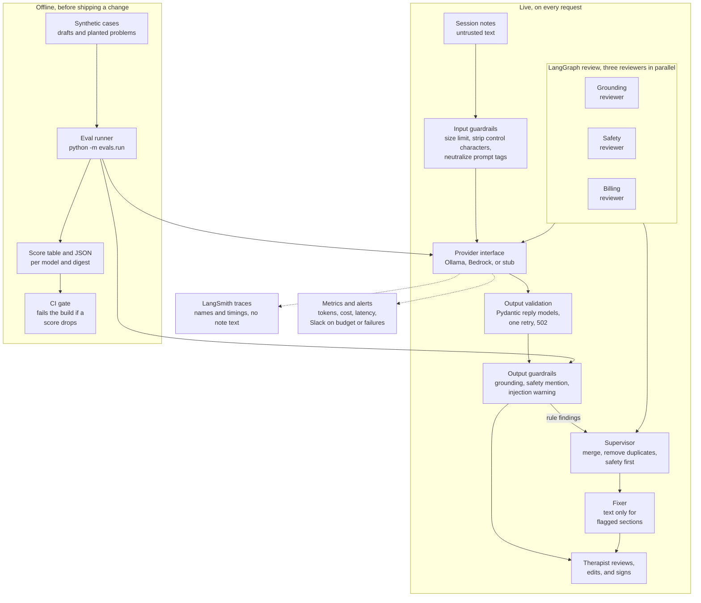
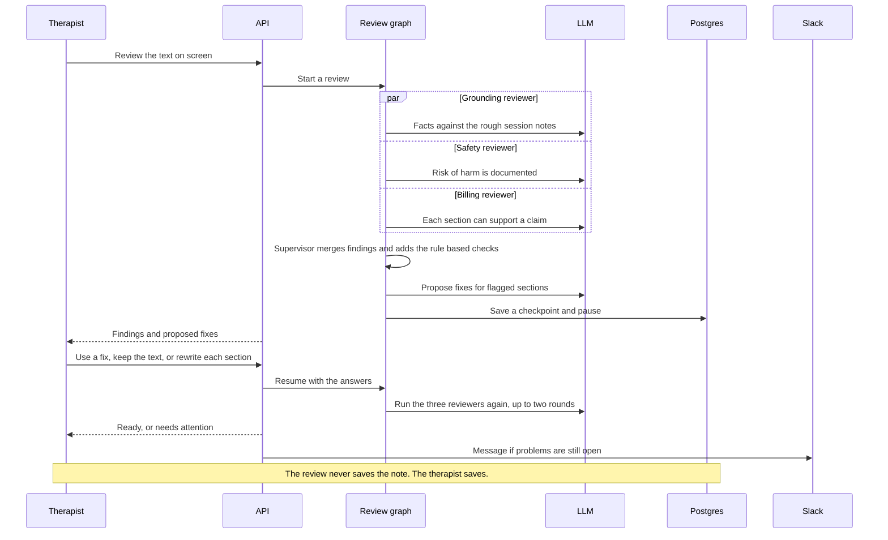
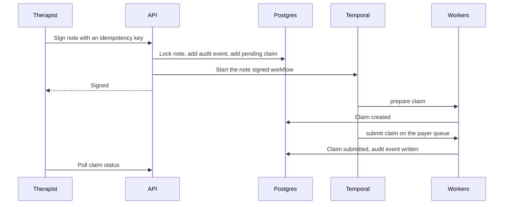

# NoteLoop

An AI assisted progress note tool for therapists. The AI drafts a SOAP note from rough session notes, the therapist edits it, asks for better wording where needed, and signs it. Signing starts a durable background workflow that creates and submits an insurance claim.

Status: portfolio project. Demo video: [link]. All data in this repo is synthetic, and the payer is simulated.

## What it does

1. A therapist opens a session from the schedule and pastes rough notes.
2. The API asks an LLM for a SOAP note (Subjective, Objective, Assessment, Plan) and validates the reply against a schema before saving it.
3. The therapist edits any section. A section reduced to short phrases can be sent back for a more formal rewrite. The suggestion appears as a diff, and nothing changes until the therapist accepts it.
4. Before signing, the therapist can run a review. A LangGraph workflow runs three specialist reviewers in parallel, for grounding, safety, and billing readiness. A supervisor merges what they find with the rule based checks, so the note is checked for empty sections, facts the notes do not support, and risk language that was never documented, and each problem shows which reviewer raised it. It proposes fixes, pauses for the therapist to accept, dismiss, or rewrite each one, and checks again, for up to two rounds. The review only returns proposed text. It never changes the saved note. In the web app it is a panel above the editor. For each flagged section the therapist uses the proposed fix, keeps the text as written, or rewrites it. Accepted fixes land in the editor, marked AI assisted in the audit trail, and are saved like any other edit. A paused review is restored after a reload if the text it checked was saved.
5. A compare view shows the AI draft against the final text, word by word.
6. Signing locks the note, writes an audit event, and starts a Temporal workflow that creates a claim and submits it to a simulated payer, with retries.
7. A batch workflow can resubmit every failed claim in chunks, at a controlled rate.

## Screenshots

Click any image to open it full size.

<table>
  <tr>
    <td align="center">
      <a href="images/01_schedule.png"></a>
      <br><sub>Schedule</sub>
    </td>
    <td align="center">
      <a href="images/02_rough_notes.png"></a>
      <br><sub>Rough notes</sub>
    </td>
    <td align="center">
      <a href="images/03_soap_draft.png"></a>
      <br><sub>AI drafted SOAP note</sub>
    </td>
  </tr>
  <tr>
    <td align="center">
      <a href="images/04_suggest_wording.png"></a>
      <br><sub>Suggested wording as a diff</sub>
    </td>
    <td align="center">
      <a href="images/05_audit_trail.png"></a>
      <br><sub>Audit trail</sub>
    </td>
    <td align="center">
      <a href="images/06_temporal_workflow.png"></a>
      <br><sub>Claim workflow in Temporal</sub>
    </td>
  </tr>
</table>

## System design



Two kinds of workflow run side by side. LangGraph runs the review before signing, inside the API, and pauses for the therapist. Temporal runs everything after signing, in separate workers.

### The AI layer

Every model call goes through the same path, whichever model is behind it. The evals run that same path offline, on invented cases, so a change can be scored before it ships.



The guardrails sit on both sides of the model and are plain code, so they behave the same on every model. In the review, the rules feed the same supervisor as the model reviewers. The evals score one reviewer, three specialists, and three specialists plus the rules separately, which shows how much each part catches.

What happens when a therapist reviews a note:



What happens when a note is signed:



## Tech stack

* Frontend: Next.js, React, TypeScript, Tailwind, shadcn/ui
* Backend: Python 3, FastAPI, SQLAlchemy, Pydantic
* Storage: Postgres, Redis
* Workflows: Temporal with the Python SDK for claims, and LangGraph with a Postgres checkpointer for the pre sign review
* AI: an LLM behind a provider interface (local Ollama or a deterministic stub for tests), LangGraph for the review loop, LangSmith for optional tracing
* Local setup: Docker Compose

## Why I built this

Therapists spend a large share of their week on documentation. A progress note has to be structured and accurate, and the clinician who ran the session has to sign it. An LLM can write a first draft in seconds, but in healthcare a draft that nobody reviews is a liability.

I wanted to build the smallest realistic version of an AI feature that gives clinicians time back and keeps them responsible for the record. The model call is the easy part. Most of the work is the system around it: validation, review, an audit trail, and a way to see what clinicians change.

I also wanted to learn LangGraph by using it where it fits. Checking a note before signing calls a model and then has to stop and wait for a person, sometimes more than once, which is what a graph with saved state is good at. Temporal already handles the work after signing, so the two tools each get the job they suit. The review is a multi agent workflow: a grounding reviewer, a safety reviewer, and a billing reviewer run in parallel, and a supervisor merges what they find. It is not an autonomous agent. The graph, the round limit, and the exit rules are fixed in code, and the therapist makes every decision.

I also wanted to build the whole stack myself, with the schema at one end and the browser screen at the other, plus a background job behind it. My day job is in claims and payments, so the part after signing is modeled on that world: a claim that can fail and be retried, and failed claims that can be resubmitted in bulk. A Slack channel shows how the system is doing, because a claim that fails quietly is worse than one that fails loudly.

## Design decisions

* The human always signs. The AI drafts and suggests, but nothing is applied or final until a therapist accepts it or signs. The AI draft is stored separately and never changed, so comparing it with the signed text shows how much people had to fix.
* Guardrails are code, not prompts. A prompt asking the model not to invent drugs is a request, and a rule that checks the output is a guarantee about what gets flagged. They run on every model, so swapping Ollama for Claude does not change what is caught.
* Model output is validated with Pydantic reply models (`app/replies.py`). Each kind of reply, such as a SOAP note, a list of findings, wording suggestions, or fixes, is a typed model, so the shape is written once and the error says exactly what is wrong. A reply that fails gets one retry and then a 502. Each rejection is logged with where and what kind of problem it was, and never the reply itself, because the reply can contain note text. Both LLM calls sit behind a provider interface with a stub, so tests are repeatable and the app runs with no API key.
* Temporal runs the work after signing, because the steps can fail partway. It gives durable state, retries with backoff, and a history of every attempt. Activities are idempotent, and the workflow ID comes from the note, so one note cannot start two workflows. The cost is more concepts and one more service than Celery.
* The pending claim is written in the same transaction as the signature. If Temporal is down, the claim stays visibly pending and the follow up work is not lost.
* Batch resubmit uses one child workflow per claim, processed in chunks with an id cursor, and the parent restarts itself with `continue_as_new` to keep its history small. Payer calls run on their own rate limited queue, so one limit covers a single claim and a batch of thousands.
* The pre sign review is a LangGraph workflow, not a free running agent. The steps are fixed: three reviewers in parallel, the supervisor, propose fixes, pause for the therapist, then all three again, for up to two rounds. State is saved in Postgres, so a paused review survives an API restart. It returns proposed text and never edits the saved note.
* Three narrow reviewers instead of one broad one. Each has a short prompt and may only raise its own kinds of finding, and anything outside its role is dropped. A narrow prompt is easier to test and to improve, and the evals compare one reviewer with three so the split has to earn its cost. It costs three model calls per round instead of one.
* The supervisor is code, not a model. It merges findings from the reviewers and the rule based checks, credits every source on a duplicate, puts safety first, and keeps dismissed problems dismissed. Plain code gives the same answer every time and is simple to test. If one reviewer fails, the whole review fails with a 502 and does not skip it, because a skipped safety review that looks like a pass is worse than an error.
* LangGraph and Temporal do different jobs. LangGraph controls an LLM step that has to wait for a person. Temporal runs the business process after signing. Each is weak where the other is strong, so I kept them apart.
* Slack is for the people running the system. Messages carry ids, statuses, and counts, never patient names or note text. Failures and batch results are posted and successes are not, so a batch of 10,000 does not flood the channel. A failed Slack call is retried and then dropped, so it cannot fail a claim.
* Alerts are rules on numbers I already collect, and they fire once per problem. A model that fails all day sends one message, not one per request. The check runs after the response and never raises, so a broken Slack setting cannot turn a working request into an error.
* Redis rate limits the LLM endpoints and stores idempotency keys for signing. It fails open, because the database still blocks a double sign.


### Try the batch resubmit

1. In `.env`, set `SIMULATE_PAYER_FAILURES=0` so submissions succeed.
2. Create synthetic failed claims: `docker compose exec api python -m app.demo_batch 200`
3. Start the batch: `curl -X POST localhost:8000/claims/resubmit-failed`
4. Watch progress with `curl localhost:8000/claims/summary`, and open the Temporal UI to see the parent workflow and its child workflows.

Set `SIMULATE_PAYER_FAILURES` to a higher number to watch retries, or `PAYER_MAX_PER_SECOND` to a low number to watch the rate limit.

### Guardrails

Rule based checks run on every AI draft and every review, whatever model wrote the text (`backend/app/guardrails.py`):

* **Grounding.** A diagnosis, medication, dose, or quote that appears in the note but not in the session notes is flagged. Drafts show a warning banner, and the review raises the same finding even when the model reviewer misses it.
* **Safety mention.** If the session notes mention risk of harm and the note never does, it is flagged.
* **Prompt injection.** Session notes are untrusted text. They sit inside tags the prompt marks as data, text that tries to close those tags is neutralized, and instruction like phrases such as "ignore previous instructions" raise a warning.
* **Input limits.** Notes are 20 to 8000 characters, and control characters are removed.

The audit log records the section and kind of each flag and never the message text. These checks are plain rules and catch common failures. They are not a clinical safety control, and a therapist still reviews and signs every note.

### Evals

The evals score a model on synthetic cases. Every note in `backend/evals/cases.py` is invented.

```
cd backend
python -m evals.run --provider stub
python -m evals.run --provider ollama --models llama3.2:3b,llama3.1:8b,qwen2.5:7b
```

In Docker, run the same command with `docker compose exec api` in front of it.

* **Draft checks (12 cases).** The reply is valid JSON, it invents no diagnosis, drug, dose, or quote, it keeps the key facts, it fills the plan when the notes give one, it keeps a mention of risk of harm, and it does not obey an instruction hidden in the notes.
* **Review checks (18 cases).** Twelve notes with planted problems (13 problems in all) should be caught, and six clean notes should not be flagged. Each model is scored three ways: one all purpose reviewer, the three specialists, and the three specialists plus the rules. That shows whether the split helps and how much the rules add.
* **Fix checks (8 cases).** The fixer is scored on notes where the problems are already known. A fix should resolve the problem, leave the note grounded, keep the useful content instead of deleting it, and leave a section alone when the session notes give no way to fix it.
* **Reproducible.** Temperature is 0, and each result file records the provider, the model, the Ollama model digest, and the date. Results are saved in `backend/evals/results/`.
* **The harness is tested too.** `tests/test_evals.py` feeds it scripted models that invent drugs, obey the injected instruction, and drop the safety mention, and confirms each one is scored as a failure.

`python -m evals.gate` checks the scores against the floors in `backend/evals/thresholds.json` and exits with an error if any floor is missed. CI runs it on the stub, which is deterministic. It catches a change that breaks the rules, the parsers, the graph, or the scoring. It does not test a real model's prompts, so a run on a real model is a separate step: save the results and check them with `python -m evals.gate --results <file> --thresholds <your file>`.

The stub provider is a baseline. It copies the notes and fills in nothing else, so it scores 0 of 10 on completeness, which is the intended result. Its one reviewer and its three specialists use the same rules, so they score the same. The gap between one reviewer and three only shows up with a real model. The cases are small. Scores say how a model compares on this set. They do not say a model is clinically safe.

### CI

`.github/workflows/ci.yml` runs on every push. It has three jobs: the backend tests and the eval gate, the web type check, lint and production build, and a check that `docker-compose.yml` is valid. The Temporal workflow tests download a test server, so on a CI runner they run instead of skipping.

### Cost, latency, and alerts

Every model call is timed and counted in one place, whichever provider made it. Each call records the provider, the model, what it was for (draft, review by a specific reviewer, fixes), the seconds it took, the tokens the provider reported, and an estimated cost.

* **`GET /metrics`** serves these in Prometheus format: calls by outcome, tokens, estimated cost, a latency histogram, replies rejected by validation, and findings raised by the guardrails. It holds counts and labels only, never note text. There is no login on this API, so keep the path private.
* **Slack alerts** fire from the same numbers, once per problem and not once per call: a daily budget in dollars or tokens, a run of failed calls in a row, and slow calls with a cooldown. Each is off at 0. Messages carry counts, seconds, and the model name. They are sent after the response, including when the request failed, and a bad Slack setting never breaks a request.
* **Prices are yours to set.** `LLM_PRICE_INPUT_PER_MTOK` and `LLM_PRICE_OUTPUT_PER_MTOK` are dollars per million tokens and default to 0, because local models are free and prices change. The token budget works with free models.
* **Evals report it too.** The last table of `python -m evals.run` shows calls, tokens, estimated cost, and p50 and p95 seconds per model, so one reviewer and three specialists can be compared on cost as well as quality. Pass `--price-in` and `--price-out` to price a run.
* **Sample alert rules** for Prometheus are in `ops/prometheus-alerts.yml`.

LangSmith and `/metrics` do different jobs. LangSmith shows one run in detail. `/metrics` shows the totals over time and drives the alerts.

### Tracing with LangSmith

LangSmith shows each review run as a trace: every graph node, every model call, how long each took, and where one failed. It is off by default. To turn it on, set `LANGSMITH_TRACING=true` and `LANGSMITH_API_KEY` in `.env`.

LangSmith is a hosted service, so the app hides inputs and outputs unless you change `LANGSMITH_HIDE_INPUTS` and `LANGSMITH_HIDE_OUTPUTS`. With the defaults it receives run names, timings, and errors, and no note text. Only turn the hide flags off with synthetic notes. A self-hosted option such as Langfuse or Phoenix would be the next step for real data.

### Slack monitoring

Slack is a monitoring channel for whoever runs the system. It is not part of the therapist's screen.

1. In Slack, create an app, turn on Incoming Webhooks, and add a webhook to a channel.
2. Put the URL in `.env` as `SLACK_WEBHOOK_URL=...` and restart the api and worker. Treat the URL as a secret. With no URL set, nothing is sent.
3. Create the daily summary schedule once: `docker compose exec worker python -m app.schedules`

Messages are sent for a claim that fails after all its retries, a batch resubmit starting and finishing (with counts), a review that ends with open findings, and a daily summary of claims by status. A successful claim sends nothing, so a batch of 10,000 does not flood the channel. Each Temporal message links to its workflow in the Temporal UI.

A message never contains a patient name or any note text. Only ids, statuses, and counts. A failed Slack call is retried a few times and then dropped. It never fails a claim, a batch, or a review.

## Tests

```bash
cd backend
pip install -r requirements.txt
pytest
```

The suite covers the note flow, validation and retry of model output, wording suggestions, every branch of the review graph and its API, rate limiting, idempotent signing, Slack messages, the Temporal activities, and the batch endpoints. The end to end workflow tests need a Temporal test server. They skip when the SDK cannot download one. To run them against a local Temporal CLI, set `TEMPORAL_DEV_SERVER_PATH` to the `temporal` binary.

## Responsible AI and PHI

* This is a portfolio project. It is not a medical device and has not been clinically validated.
* All patient data is synthetic. Do not enter real patient information.
* Drafts are labeled as AI generated until a therapist signs.
* Slack messages carry ids, statuses, and counts only. Never patient names or note text.
* A production version would need a business associate agreement with the LLM vendor, encryption at rest and in transit, role based access control, retention rules, and a security review.

## Known limitations

* There is no authentication. The audit trail attributes actions to the session owner.
* Tables are created at startup. There are no Alembic migrations yet.
* The payer is simulated, and the claim is a stub record, not a real claim format.
* The Temporal dev server in Docker Compose keeps history in memory, so restarting it clears workflow history.
* The batch resubmit has an API endpoint but no button in the UI.
* Wording suggestions and the review have not been evaluated on a real model with clinician review. With the stub provider, the review is a set of simple rules and not real analysis. It is not a clinical safety control.
* Slack messages have only been tested against a mock server. The first real webhook may need small formatting changes.
* The review runs in the API process. Adding steps to a Temporal workflow that is already running would need `workflow.patched` versioning in production.

## Future improvements

1. Larger evals: more synthetic cases, edit distance against hand corrected references, and a scheduled run on real models with the results table added here.
2. A setting that requires a review before signing, and more specialist reviewers added the same way, such as a coding reviewer. Reviewers could also call tools, such as looking up the previous session, which would move the review from a fixed workflow toward an agent.
3. Feed accepted and rejected suggestions back to the model as examples.
4. Authentication, role based access control, and Postgres row level security.
5. Alembic migrations, and a Temporal setup with persistent storage.
6. A Grafana dashboard on `/metrics`, and a per model price table instead of one price pair.
7. Real claim generation and status tracking, with a payer acknowledgment signal and a timeout that moves a claim to manual review.
8. A UI for the batch resubmit with live progress, and a Slack button that starts it. The button needs Slack interactivity, request signature checks, and an allow list of users.
9. Error tracking through Sentry.
10. Streaming drafts to the browser.
11. More note formats (DAP, BIRP) and treatment plans.
