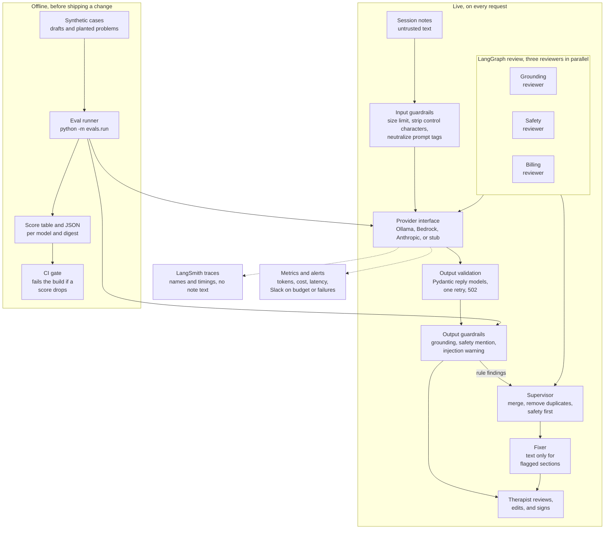
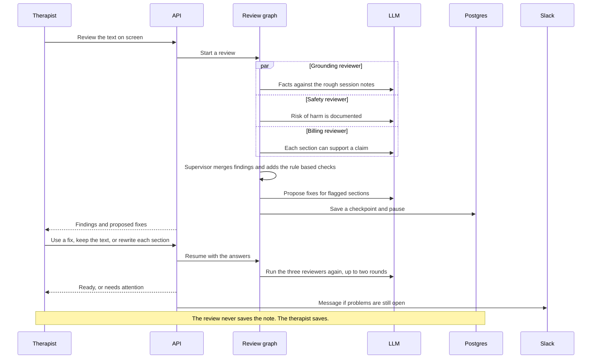
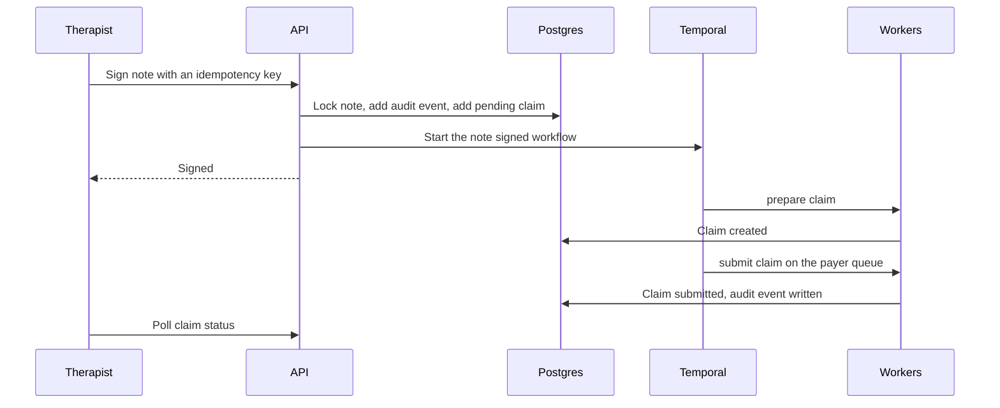

# AI layer and workflows

How a model call is guarded, validated and scored, and how the review and signing workflows run. Back to the [README](../README.md).

Every model call goes through the same path, whichever model is behind it. The evals run that same path offline, on invented cases, so a change can be scored before it ships.

The guardrails sit on both sides of the model and are plain code, so they behave the same on every model. In the review, the rules feed the same supervisor as the model reviewers. The evals score one reviewer, three specialists, and three specialists plus the rules separately, which shows how much each part catches.

What happens when a therapist reviews a note:

What happens when a note is signed:

